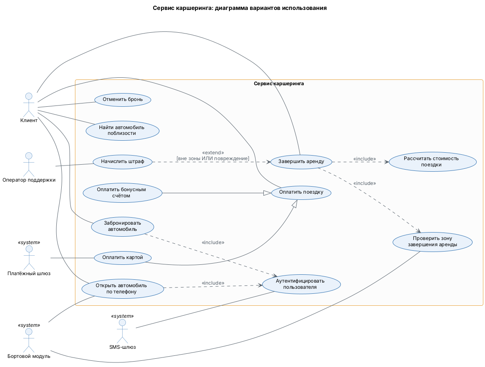
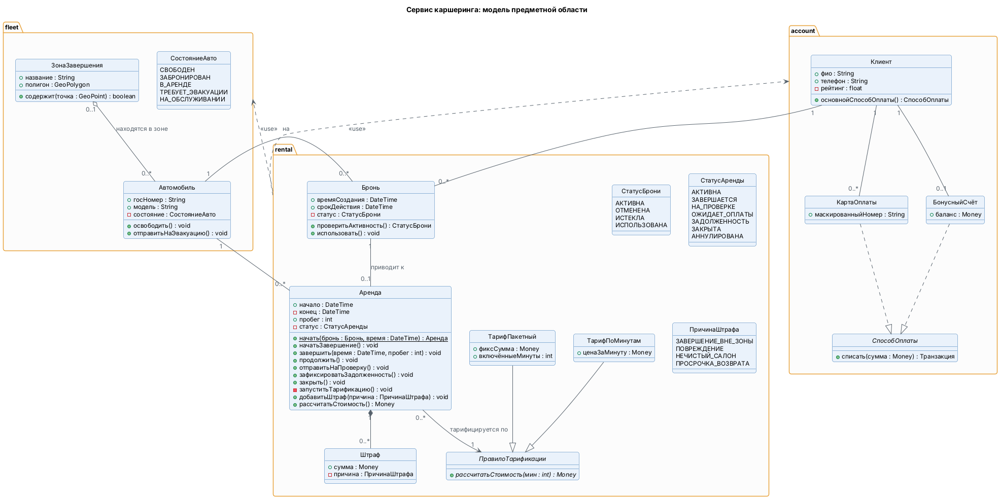
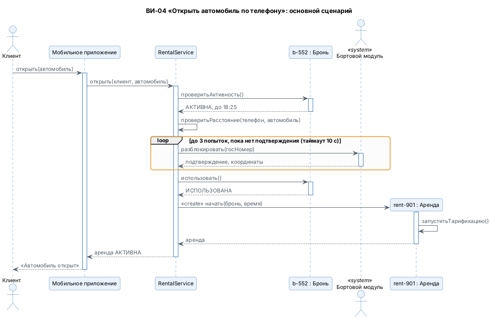
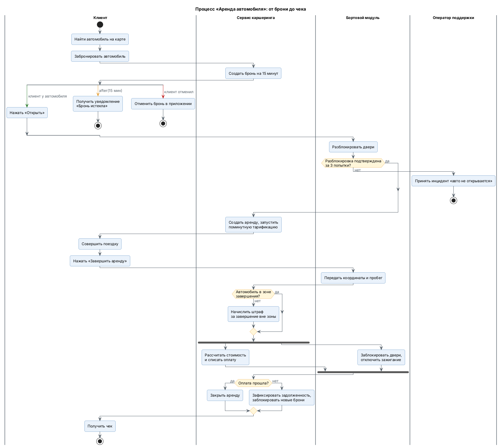
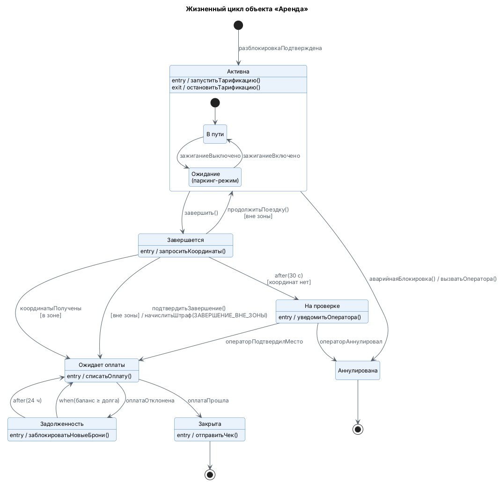
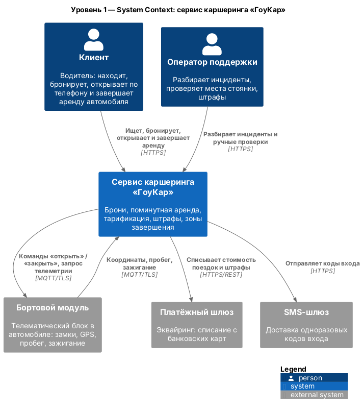
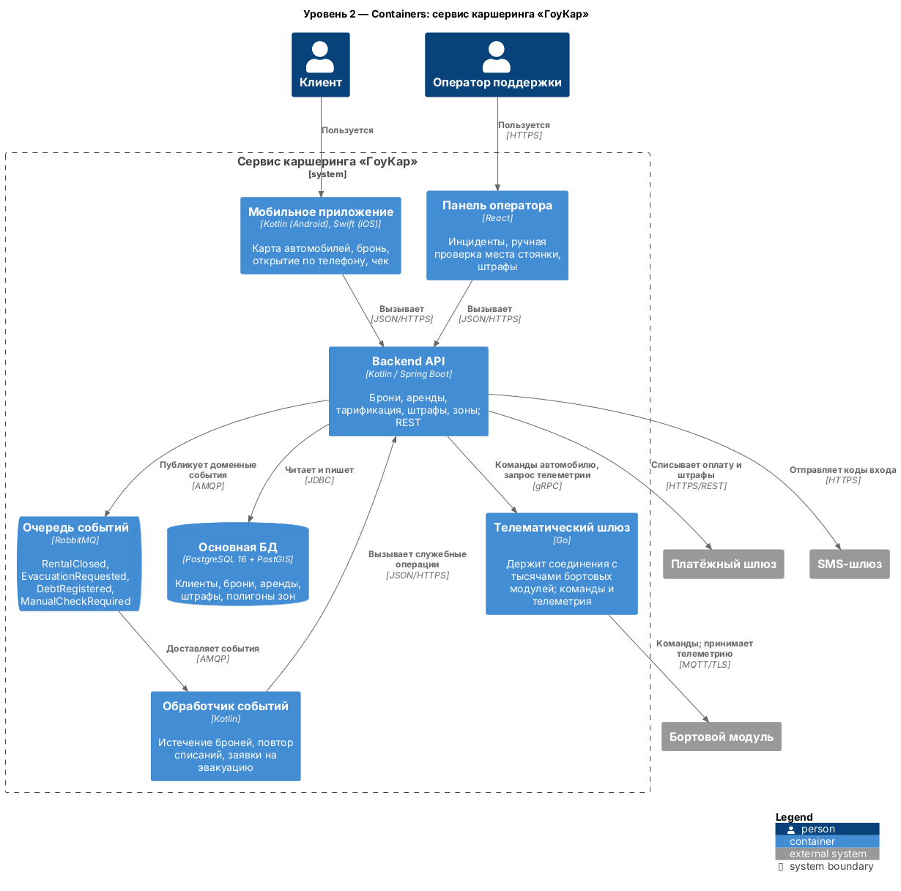
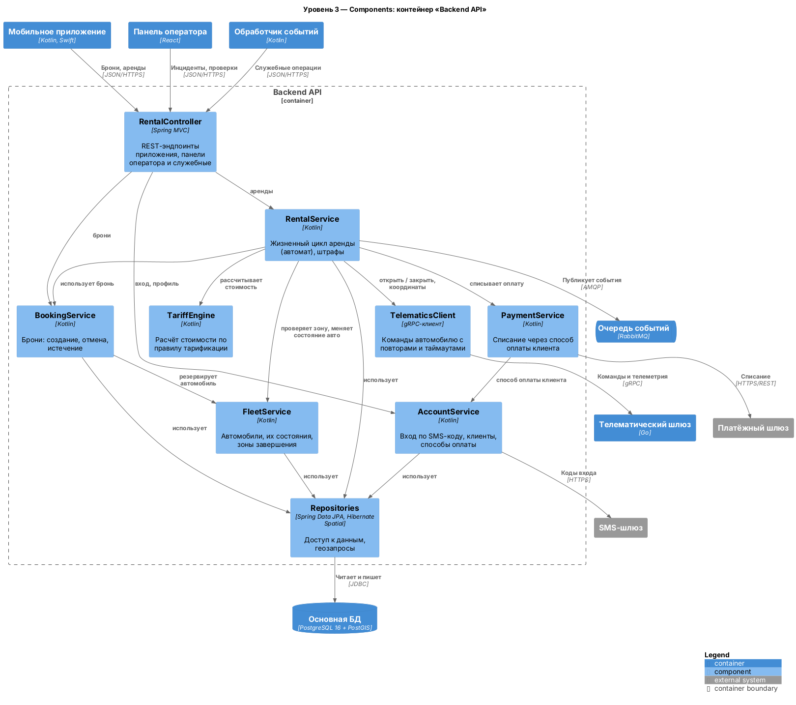
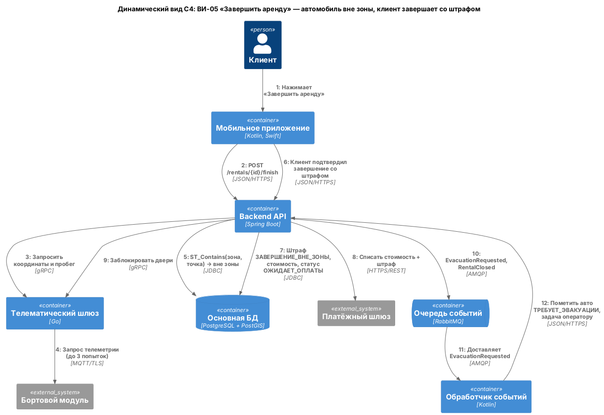
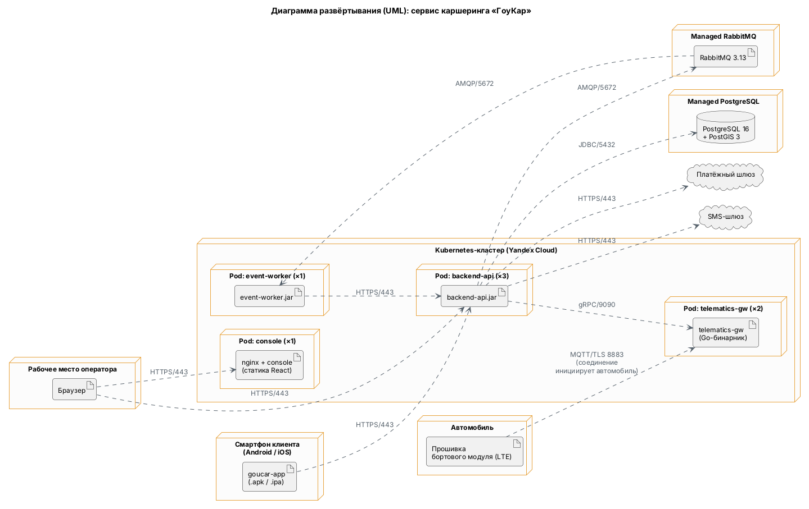

# Сервис каршеринга «ГоуКар». Архитектурная документация

Документ сводит модель, построенную в трёх практических работах: требования
(ПР1), динамику (ПР2) и архитектуру (ПР3). Читается сверху вниз; исходники
всех диаграмм — в `docs/**/*.puml` и `docs/06-c4/workspace.dsl`, картинки
пересобираются CI при каждом пуше (`.github/workflows/diagrams.yml`).

---

## 1. Назначение и границы

«ГоуКар» — сервис поминутной аренды автомобилей без офиса и ключей. Клиент
находит свободную машину на карте, бронирует её на 15 минут, открывает
нажатием кнопки в приложении и платит за фактические минуты поездки. Главная
задача системы — превратить автомобиль, стоящий на улице, в услугу, за
которую можно взять деньги без участия человека: проверить, кто открывает
машину, посчитать стоимость и списать её, а если машину бросили где попало —
выставить штраф и вызвать эвакуатор.

Внутри границ — бэкенд (брони, аренды, тарификация, штрафы, зоны), мобильное
приложение клиента, панель оператора и телематический шлюз. Вне границ —
сам автомобиль и его бортовой модуль (поставляет производитель телематики),
процессинг банковских карт (платёжный шлюз) и доставка SMS. Система
доверяет только тому, что сообщает бортовой модуль: координаты телефона
клиента для решений о штрафах не используются (см. ADR-0003).

## 2. Заинтересованные стороны и их цели

| Сторона | Тип | Цель в системе |
|---|---|---|
| Клиент | человек, первичный | найти, забронировать, открыть по телефону, доехать и оплатить поездку |
| Оператор поддержки | человек, первичный | разбирать инциденты, ручные проверки места стоянки и спорные штрафы |
| Платёжный шлюз | внешняя система | списать деньги с карты и вернуть статус транзакции |
| Бортовой модуль | внешняя система | выполнить команды «открыть/закрыть», передать координаты, пробег, зажигание |
| SMS-шлюз | внешняя система | доставить одноразовый код входа |

Подробнее — `docs/01-usecase/actors.md`. SMS-шлюз добавлен в ПР3 по итогам
аудита согласованности (пункт 1).

## 3. Функциональные требования

Диаграмма построена вокруг двух ценных для бизнеса моментов — «Открыть
автомобиль по телефону» и «Завершить аренду». Всё остальное либо готовит
их (поиск, бронь, вход), либо является их частью: проверка зоны и расчёт
стоимости включены (`include`) в завершение, потому что без них завершить
аренду нельзя, а штраф — расширение (`extend`), потому что срабатывает
только вне зоны или при повреждении. Оплата обобщает два способа, и это не
косметика: картой платят через внешний шлюз, бонусами — без него, и это
разные отказы.

| ВИ | Суть |
|---|---|
| ВИ-01 Найти автомобиль поблизости | свободные машины на карте в радиусе от клиента |
| ВИ-02 Забронировать автомобиль | бесплатное ожидание 15 минут, машина пропадает из поиска |
| ВИ-03 Отменить бронь | машина возвращается в поиск |
| ВИ-04 Открыть автомобиль по телефону | команда разблокировки через бортовой модуль, старт поминутной тарификации |
| ВИ-05 Завершить аренду | проверка зоны, расчёт, списание, блокировка дверей |
| ВИ-06 Проверить зону завершения | попадание координат автомобиля в многоугольник зоны |
| ВИ-07 Рассчитать стоимость поездки | минуты × тариф (поминутный или пакетный) + штрафы |
| ВИ-08 Оплатить поездку | списание выбранным способом, без двойного списания |
| ВИ-09 Оплатить картой | через платёжный шлюз по токену карты |
| ВИ-10 Начислить штраф | вне зоны, повреждение, грязный салон, просрочка |
| ВИ-11 Аутентифицировать пользователя | вход по номеру телефона и SMS-коду |
| ВИ-12 Оплатить бонусным счётом | списание с внутреннего баланса |

Два подробных сценария по шаблону Коберна, с исключениями —
`docs/01-usecase/scenarios.md` (ВИ-04 и ВИ-05). Нефункциональные требования
к каждому ВИ — `docs/01-usecase/traceability.md`.

## 4. Модель предметной области

Модель разбита на три пакета по тому, что меняется вместе: `account` (клиент
и способы оплаты) меняется при подключении нового способа оплаты, `fleet`
(автомобили и зоны) — при расширении географии, `rental` (бронь, аренда,
тарифы, штрафы) — при изменении правил бизнеса. Зависимости идут из ядра
наружу: `rental` использует `fleet` и `account`, но не наоборот. Это
направление исправлено в ПР3 — изначально оно было нарисовано зеркально
(аудит, пункт 8).

Три решения, которые стоит знать до чтения кода:

- **Штраф — часть аренды (композиция).** Штраф без поездки не имеет смысла и
  может добавиться даже к закрытой аренде (повреждение по фотоотчёту).
- **У аренды явный статус из 7 значений**, совпадающих с состояниями автомата
  раздела 5.3, — а не набор флагов. Почему — в ADR-0001.
- **Бронь знает свой автомобиль напрямую**, а не через аренду: аренды у брони
  ещё нет, а проверить «бронь именно на эту машину» нужно до открытия
  (исправлено в ПР3, аудит пункт 10).

Остальные решения с альтернативами — `docs/02-domain/decisions.md`
(Р-1…Р-7).

## 5. Динамика

### 5.1 Основной сценарий — диаграмма последовательности

Открытие по телефону — самое рискованное место системы: между нажатием кнопки
и щелчком замка проходят мобильная сеть клиента, сервер, телематический шлюз и
сотовая связь автомобиля. Поэтому команда разблокировки обёрнута в цикл из
трёх попыток по 10 секунд, а аренда создаётся **только после подтверждения**
от бортового модуля: если машина не открылась, клиента не за что тарифицировать.
Исключения этого сценария (нет связи, клиент далеко, бронь истекла) и
сценарий завершения аренды с четырьмя исходами — в `alt-flow.puml`, оплата
(ВИ-08) — в `payment.puml`.

### 5.2 Бизнес-процесс — диаграмма деятельности

Процесс показывает, кто что делает от брони до чека. Важны три места. Первое:
после брони процесс может закончиться тремя способами (клиент дошёл, бронь
истекла через 15 минут, клиент отменил) — это внешние события, а не решения
системы. Второе: если машина не открылась за три попытки, процесс уходит к
оператору, а не повторяется бесконечно. Третье: при завершении расчёт оплаты
и блокировка дверей идут параллельно — они независимы, и порядок их не важен.
Анализ переходов между дорожками и параллелизма — `docs/04-activity/analysis.md`.

### 5.3 Жизненный цикл ключевого объекта — конечный автомат

Автомат «Аренды» — самая точная спецификация бизнес-правил в модели. Из него
видно то, что легко упустить в сценариях: клиент, оказавшийся вне зоны, может
вернуться в поездку, а не только заплатить штраф; неоплаченная аренда не
«закрывается», а уходит в задолженность и через сутки снова пытается
списать деньги; если бортовой модуль молчит дольше 30 секунд, решение
переходит к оператору. Все эти переходы были найдены при построении автомата
и полной таблицы переходов (`docs/05-state/transitions.md`) и перенесены в
сценарии и модель классов.

## 6. Архитектура

### 6.1 Контекст (C4 L1)

С системой работают два типа людей и три внешние системы. Связь с
автомобилем двусторонняя и асинхронная: система отправляет команды, а модуль
сам присылает телеметрию. Это первое, что нужно понимать про каршеринг:
автомобиль — не сервер, к которому можно обратиться, а устройство в сотовой
сети, которое само выходит на связь.

### 6.2 Контейнеры (C4 L2)

Семь контейнеров, и каждый выделен потому, что разворачивается и
перезапускается отдельно по своей причине. **Телематический шлюз** держит
тысячи постоянных соединений с автомобилями и не должен рваться при выкладке
API (ADR-0002). **Обработчик событий** живёт по таймерам — истечение броней,
повтор списаний, заявки на эвакуацию — и не должен срабатывать дважды, поэтому
он один. **Очередь событий** отделяет ответ клиенту от медленных и ненадёжных
действий: если служба эвакуации не ответила, аренда всё равно закрыта.
**Основная БД** хранит полигоны зон рядом с остальными данными, и проверка
зоны — это пространственный запрос (ADR-0003).

### 6.3 Компоненты (C4 L3)

Раскрыт самый сложный контейнер — Backend API. Компоненты прослеживаются до
пакетов модели предметной области:

| Компонент | Пакет ПР1 | Классы |
|---|---|---|
| AccountService | account | Клиент, КартаОплаты, БонусныйСчёт |
| PaymentService | account | СпособОплаты |
| FleetService | fleet | Автомобиль, СостояниеАвто, ЗонаЗавершения |
| BookingService | rental | Бронь, СтатусБрони |
| RentalService | rental | Аренда, СтатусАренды, Штраф, ПричинаШтрафа |
| TariffEngine | rental | ПравилоТарификации, ТарифПоМинутам, ТарифПакетный |
| RentalController, TelematicsClient, Repositories | — | инфраструктура, классов предметной области нет |

`RentalService` — центр: он единственный, кто меняет статус аренды, и через
него идут все внешние действия (команды автомобилю, оплата, события). На
диаграммах последовательности ПР2 он и есть участник `RentalService`.

Как это выглядит в одном сценарии на уровне контейнеров — динамический вид
завершения аренды вне зоны:

Двенадцать шагов показывают, где сценарий ВИ-05 выходит за пределы одного
процесса: два обращения к телематике (координаты, затем блокировка),
геозапрос в БД, внешний платёж, и только после ответа клиенту — асинхронная
цепочка до заявки на эвакуацию.

### 6.4 Развёртывание

Физическое размещение отвечает на вопросы, которых нет на C4: соединение
MQTT/TLS 8883 открывает автомобиль (у него нет входящего адреса в сети LTE),
API запущен в трёх экземплярах без состояния, обработчик событий — в одном,
а БД и брокер сообщений — управляемые сервисы облака вне Kubernetes.

## 7. Архитектурные решения

| ADR | Суть |
|---|---|
| [ADR-0001](adr/0001-статус-аренды-явным-полем.md) | Жизненный цикл аренды — явный enum `СтатусАренды`, а не набор флагов: невозможные комбинации невыразимы, автомат переносится в код дословно |
| [ADR-0002](adr/0002-телематический-шлюз-отдельным-контейнером.md) | Связь с автомобилями — отдельный контейнер на Go, а не модуль API и не облачная IoT-платформа: выкладка API не рвёт связь с парком |
| [ADR-0003](adr/0003-проверка-зоны-на-сервере-postgis.md) | Зона проверяется на сервере запросом PostGIS по координатам бортового модуля, а не в приложении: штраф нельзя начислять по данным клиентского устройства |

## 8. Что осталось за рамками

- **ВИ-11 «Аутентифицировать пользователя» без динамической диаграммы.** Вход
  по SMS-коду — типовой механизм, в нём нет специфики каршеринга; на C4 он
  виден как `AccountService → SMS-шлюз`. Это единственный ВИ без динамики
  (аудит, пункт 7).
- **Регистрация и проверка водителя.** Реальный каршеринг не пустит за руль
  без проверки водительского удостоверения и стажа. В модели клиент
  появляется уже проверенным; ни ВИ, ни классов для этого нет.
- **Push-уведомления.** На диаграмме деятельности клиент «получает
  уведомление «Бронь истекла»», но канал доставки не смоделирован: ни
  контейнера, ни внешнего сервиса push (APNs/FCM) на C4 нет. Сейчас это
  противоречие закрыто только оговоркой.
- **Обслуживание парка.** В `СостояниеАвто` есть `НА_ОБСЛУЖИВАНИИ`, но ни
  один сценарий не переводит в него автомобиль — заправка, мойка, ремонт и
  роли сотрудников техслужбы не моделировались.
- **Автомат брони.** У брони 4 состояния и почти линейный цикл, отдельная
  диаграмма не рисовалась; переходы видны на диаграмме деятельности.
- **Маршрутизация команд между экземплярами телематического шлюза.**
  Какой из двух экземпляров держит соединение с конкретной машиной — открытый
  вопрос ADR-0002.
- **Картографический сервис.** Подложку карты приложение получает напрямую от
  провайдера карт через его SDK; система этим не управляет, поэтому на
  Context провайдера нет.
- **Тарифы.** Смоделированы только поминутный и пакетный тарифы; ночной,
  динамический (по спросу) тарифы и страховка — нет.
- **Сквозные требования.** Защита персональных данных (152-ФЗ), мониторинг,
  резервное копирование и аварийное восстановление в модели не отражены.
